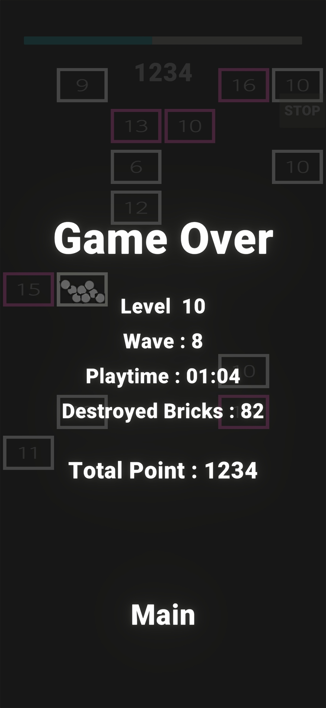
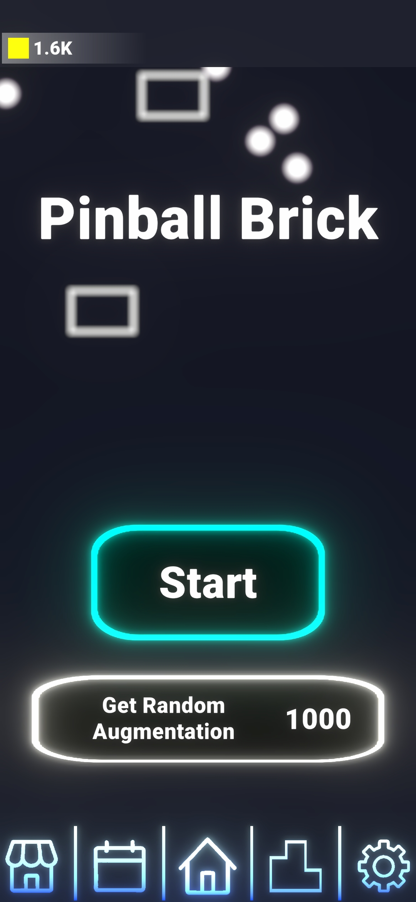
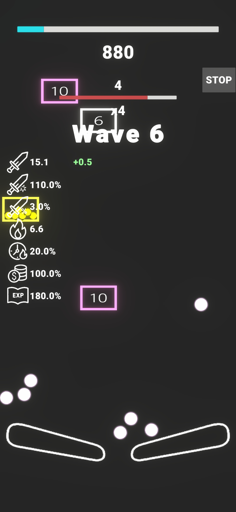
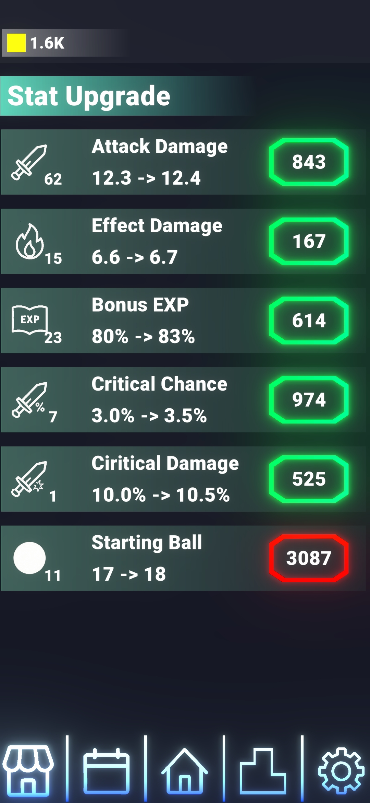
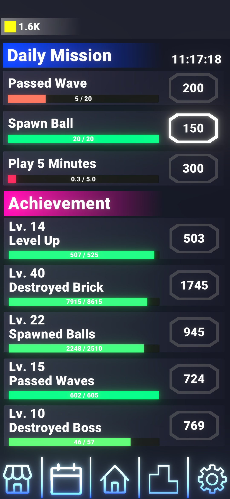
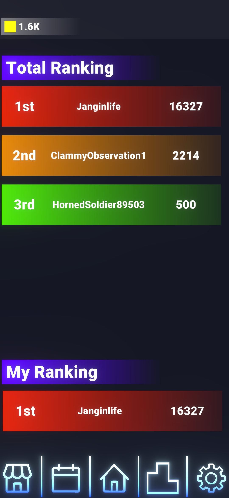

# PinballBricks

**[English](#english)** | **[한국어](#korean)**

<table>
  <tr>
    <th align="center">Game Over</th>
    <th align="center">Main</th>
    <th align="center">Gameplay</th>
  </tr>
  <tr>
    <td align="center" width="33%"></td>
    <td align="center" width="33%"></td>
    <td align="center" width="33%"></td>
  </tr>
</table>

 

## English

> Development period: January 2025 – July 2025 (about 7 months, 2-person team)

PinballBricks is a mobile survivors-like game that combines pinball and brick breaking.

You control the flippers at the bottom to bounce the ball into bricks, and build your own run from level-up stats and 130+ augments.

It is integrated with Google Play Games to support a global leaderboard, achievements, and cloud saves.

### Team

| Member | Main areas |
| --- | --- |
| woojinss | Augment system, brick/wave system, ball and stats, level-up flow, Google Play Games integration (leaderboard, achievements, cloud save) |
| dolsot | Shader Graph effects, sound, items (gold, EXP, dice), UI design |

 

### Gameplay

**Controls**: The screen is split in half by a vertical line. Touching the right half operates the right flipper, and touching the left half operates the left flipper.

- **How to play**: Use the left and right flippers to hit the ball up into the bricks. If there is no ball on the field for 3 seconds in a row, the game is over.

- **Waves**: The current wave number is shown on screen every time a new wave begins. Every 10th wave is a boss wave: the next wave does not start until the boss is destroyed, and if it is not destroyed within 60 seconds, the game is over.

- **Bricks**: There is a basic brick and 9 ability bricks. 3 special bricks also appear occasionally, and each one provides its own unique effect every set number of hits.

- **Growth**: At the first level-up and every 5 levels after that, you choose one of 3 augments. At all other levels, you choose one of 3 random stats out of 8 (Attack Damage, Critical Damage, Critical Chance, Effect Damage, Effect Duration, Gold Gain, EXP Gain, Summon Balls).

- **Fever**: Destroying bricks in a row raises the score multiplier up to x16, and it is applied to the accumulated score when the gauge runs out.

 

### Technical Implementation

#### 1. Augment System

- PinballBricks has an augment system to strengthen randomness and maximize the thrill that comes with it.

- **Rarity**: Every augment has a grade. There are 6 grades in total: from grade 5 (lowest) to grade 1 (highest), plus grade 0, which cannot be obtained through normal means.
  - Each grade has a different appearance chance. This keeps powerful augments hard to get for the sake of balance, but it also lets each grade show its own distinct presentation, giving the player a familiar yet exciting thrill.

  - Augments that have already been picked are locked, and the 3 options shown at once are tracked separately so they never overlap.

- **Implementation**: Every augment is implemented through the `IAugment` interface. The interface comes with several classes as base implementations, which distinguish what kind of augment it is (e.g. one that simply raises stats or one that performs a special attack) and make augments easier to diversify and manage.

  - Augments are split into three abstract classes that derive from `IAugment`: `StatAugment` holds augments that simply raise stats, `FieldAugment` holds augments that share a cooldown and affect the whole field, and `SpecialAugment` holds augments with special effects such as fire and poison.

  - There are also `FollowUpAugment` augments, which start in a locked list and do not appear at first. When a base augment is applied, it calls `UnlockAugmentByType` to unlock every `FollowUpAugment` of the same type.
    - For example, taking the **FireBall** augment unlocks all `"Fire"` type augments, so augments such as increased fire duration or fire explosion can start appearing in later choices. If the base augment is removed, they are locked again and no longer appear.

#### 2. Wave Generation and Balancing

Brick composition and strength are calculated from the wave number by formulas, and the coefficients were tuned in an Excel sheet.

- **Brick spawning**: Bricks are spawned with **object pooling** to prevent frame drops caused by instantiating and destroying too many bricks.

- **Brick type weights**: Each type gets a **Gaussian weight** (σ = 55) centered 20 waves apart, so the brick mix does not change suddenly but gradually shifts toward newer bricks.
  - Each type also has its own unlock wave (in steps of 10 waves), and the weight of types that are not unlocked yet is split between the basic brick and the heal brick.

- **Count and HP**: Each wave spawns `10–15 + min(wave / 10, 10)` bricks. Normal brick HP scales with `(wave + 5·tier + 1)^1.1`, while boss HP uses an exponent of 1.2 multiplied by about 5, each with a small random spread.

- **Boss type**: Determined by the wave band (Hard for waves 11–20, Slime for waves 21–30, and so on). The boss serves as a preview of the brick mechanic newly introduced in that band.

- **Special bricks**: From wave 5, the special brick spawn chance accumulates with every brick spawned and resets once one appears. This keeps them rare while making sure they never go too long without appearing.

- **Rapid waves**: After wave 10, a Rapid wave with a much shorter spawn interval can occur. Its chance starts at 0%, rises by 9% with every normal wave, and resets when it triggers.
  - It only appears from wave 10 onward, so that a Rapid wave in the early waves does not overwhelm the player.

#### 3. Google Play Games Integration and Saving

- **Leaderboard**: The score is submitted on game over. The ranking tab loads the top 100 players in pages of 25 with `LoadScores` / `LoadMoreScores`, and looks up the player's own rank separately. Without a connection, it shows the local high score.

- **Achievements**: Each of the 21 Google Play Games achievements is wrapped in a small class that reports progress based on play statistics.

- **Daily missions**: 3 missions are drawn from the mission database and reset at 00:00 UTC (9 AM KST), with the remaining time shown in the UI. Achievements accumulate play statistics and pay gold each time a tier is passed.

- **Cloud save**: Shop upgrades, gold, and lifetime statistics are serialized to JSON and stored with Saved Games. If the player is not signed in or the request fails, the same JSON is saved to a local file instead.

 

### Out-of-Game Screens

A bottom menu switches between Shop, Missions & Achievements, Main, Ranking, and Settings.

| Screen | Details |
| --- | --- |
| Shop | Upgrade starting stats with gold, such as Attack Damage, Effect Damage, Bonus EXP, Critical Chance, Critical Damage, and the number of starting balls. |
| Missions & Achievements | Daily missions and cumulative achievements, both rewarding gold. |
| Main | Start the game. Paying 1,000 gold lets you start with one random augment. |
| Ranking | Global leaderboard. Shows the local record when offline. |
| Settings | Adjust BGM and SFX volume, and reset the game. |

<table>
  <tr>
    <th align="center">Shop</th>
    <th align="center">Missions & Achievements</th>
    <th align="center">Ranking</th>
  </tr>
  <tr>
    <td align="center" width="33%"></td>
    <td align="center" width="33%"></td>
    <td align="center" width="33%"></td>
  </tr>
</table>

 

### Tech Stack

**Unity 6 (6000.0.60f1)** · C# · URP 2D · Shader Graph · Input System · DOTween · Redcode.Pools · Google Play Games Plugin for Unity

 

---

## 한국어

> 개발 기간: 2025년 1월 ~ 2025년 7월 (약 7개월, 2인 개발)

핀볼과 벽돌깨기를 합친 뱀서라이크 모바일 게임입니다. 

아래쪽 플리퍼를 조작해 공을 튕겨 블록을 깨고, 레벨업 스탯과 130종 이상의 증강으로 자신만의 빌드를 만들어 갈 수 있습니다. 

Google Play Games와 연동해 글로벌 랭킹, 업적, 클라우드 저장을 지원합니다.

### 팀 구성

| 팀원 | 주요 담당 |
| --- | --- |
| 송우진 | 증강 시스템, 블록·웨이브 시스템, 공과 스탯, 레벨업 흐름, Google Play Games 연동(랭킹·업적·클라우드 저장) |
| 이주호 | Shader Graph 이펙트, 사운드, 아이템(골드·경험치·주사위), UI 디자인 |

 

### 게임 플레이

**조작**: 화면의 세로 절반을 가르는 선을 기준으로 오른쪽 화면을 터치하면 오른쪽 플리퍼가, 왼쪽 화면을 터치하면 왼쪽 플리퍼가 작동합니다.

- **플레이 방법**: 좌우 플리퍼를 사용해 공을 쳐 올려 블록을 깹니다. 필드에 공이 하나도 없는 상태가 3초간 이어지면 게임 오버가 됩니다.

- **웨이브**: 웨이브가 넘어갈 때마다 현재 웨이브를 화면에 표시합니다. 10의 배수 웨이브는 보스 웨이브로, 보스를 깨기 전에는 다음 웨이브가 시작되지 않고 60초 안에 깨지 못하면 게임 오버가 됩니다.

- **블록**: 기본 블록과 능력 블록 9종이 있고, 가끔 등장하는 스페셜 블록 3종은 타격 시 정해진 횟수마다 해당 블록 고유의 기능을 제공합니다.

- **성장**: 첫 레벨업과 그 이후 5레벨마다 증강 3개 중 하나를 고르고, 나머지 레벨에서는 스탯 8종(공격력, 치명타 공격력, 치명타 확률, 이펙트 공격력, 이펙트 지속시간, 골드 획득량, 경험치 획득량, 공 소환) 중 무작위 3개에서 하나를 고릅니다.

- **피버**: 블록을 연속으로 깨면 점수 배수가 최대 16배까지 오르고, 게이지가 다 닳을 때 누적 점수에 곱해 정산합니다.

 

### 기술 구현

#### 1. 증강 시스템

- PinballBricks에서는 무작위성을 강화하고 이에 따라오는 쾌감을 극대화하기 위해 증강 시스템이 존재합니다. 
  
- **등급**: 모든 증강들에는 등급이 존재합니다. 등급은 최하 5등급부터 최고 1등급, 더해서 일반적인 방법으로는 획득할 수 없는 0등급까지 총 6가지의 등급이 존재합니다. 
  - 등급마다 증강 등장 확률이 다른데, 이는 단순히 게임의 밸런스를 위해 강력한 증강을 획득하기 어렵게 하기 위함도 있지만 해당 증강의 등급에 따라 독특한 연출을 보여주기도 하면서 플레이어에게 익숙하지만 짜릿한 쾌감을 선사하는 역할도 겸합니다.

  - 이후 이미 고른 증강은 잠그고, 한 번에 제시하는 3개는 따로 추적해 서로 겹치지 않게 했습니다.

- **구현**: 모든 증강들은 `IAugment`라는 인터페이스를 사용해 구현했습니다. 인터페이스에는 해당 증강이 어떤 종류의 증강인지(단순하게 스탯만 올리는 증강인지 혹은 특별한 공격을 하는 증강인지 등) 구분하고 이를 더 다양화하면서 관리하기 쉽도록 여러 클래스가 기본 구현으로 들어 있습니다.

  - 증강들은 `IAugment`를 부모로 두는 세 가지 추상 클래스로 나뉩니다. 이는 증강 간의 `StatAugment`는 단순히 스탯만을 올리는 증강들이 속하고, `FieldAugment`는 공용 쿨타임을 가지고 필드 전체에 영향을 주는 증강들이 속하며, `SpecialAugment`는 화염, 독과 같은 특별한 효과들을 가진 증강들이 속합니다.

  - `FollowUpAugment` 증강이 존재하는데, 이 증강들은 처음에는 잠금 목록에 들어가 등장하지 않습니다. 하지만 기반 증강이 적용될 때 `UnlockAugmentByType`을 호출해 같은 타입의 모든 `FollowUpAugment`를 해제합니다. 
    - 예를 들어 **FireBall** 증강을 얻으면 `"Fire"` 타입 증강이 모두 풀려, 이후 선택지에 화염 지속시간 증가나 화염 폭발 증강이 등장할 확률이 생깁니다. 기반 증강이 제거되면 다시 잠겨 등장하지 않게 됩니다.

#### 3. 웨이브 생성과 밸런싱

블록 구성과 강도는 웨이브 번호에서 수식으로 계산하고, 계수는 엑셀 시트에서 조정했습니다.

- **블록 생성**: 블록 생성은 너무 많은 블록이 Instantiation 되었다가 Destroy 되어 프레임이 끊기는 현상을 방지하기 위해서 **오브젝트 풀링**을 사용해서 블록을 생성했습니다.

- **블록 종류 가중치**: 종류마다 20웨이브 간격으로 중심을 둔 **가우시안 가중치**(σ = 55)를 줘서, 블록 구성이 갑자기 바뀌지 않고 점차 새로운 블록 쪽으로 옮겨갑니다.       
  - 종류별 해금 웨이브(10웨이브 단위)도 따로 두어, 아직 해금되지 않은 종류의 가중치는 기본 블록과 힐 블록에 나눠줍니다.

- **개수와 체력**: 한 웨이브에 `10~15 + min(웨이브 / 10, 10)`개가 나옵니다. 일반 블록 체력은 `(웨이브 + 5·구간 + 1)^1.1`에 비례하고, 보스는 지수 1.2에 약 5배를 곱하며, 각각 약간의 무작위 편차를 둡니다.

- **보스 종류**: 웨이브 구간에 따라 정해집니다(11~20웨이브는 Hard, 21~30웨이브는 Slime 등). 보스가 그 구간에 새로 나오는 블록의 특성을 먼저 보여 주는 역할을 수행합니다.

- **스페셜 블록**: 5웨이브부터 블록이 하나 나올 때마다 스페셜 블록의 등장 확률이 누적되고, 한 번 등장하면 초기화됩니다. 희귀하지만 너무 오래 안 나오는 일은 없도록 설계했습니다.

- **Rapid 웨이브**: 10웨이브 이후에는 생성 간격이 훨씬 짧은 Rapid 웨이브가 나올 수 있습니다. 확률은 0%에서 시작해 일반 웨이브마다 9%씩 오르고 발동하면 초기화됩니다.
  - 너무 낮은 웨이브에서 Rapid 웨이브가 나와서 플레이가 버거워지는 불상사를 막기 위해 최소 10 웨이브 이후부터 등장합니다. 

#### 5. Google Play Games 연동과 저장

- **랭킹**: 게임 오버 시 점수를 등록합니다. 랭킹 탭은 `LoadScores` / `LoadMoreScores`로 상위 100명을 25명씩 페이지 단위로 불러오고, 내 순위는 따로 조회합니다. 연결이 없으면 로컬 최고 기록을 보여줍니다.
  
- **업적**: Google Play Games 업적 21개를 각각 작은 클래스로 감싸, 플레이 통계로 진행도를 보고합니다.
  
- **데일리 미션**: 미션 데이터베이스에서 3개를 뽑고, UTC 00:00(한국 시간 오전 9시)에 초기화하며 남은 시간을 UI에 표시합니다. 업적은 플레이 통계를 누적해 구간을 넘을 때마다 골드를 지급합니다.

- **클라우드 저장**: 상점 강화, 골드, 누적 통계를 JSON으로 직렬화해 Saved Games에 저장합니다. 로그인이 안 되어 있거나 요청이 실패하면 같은 JSON을 로컬 파일에 저장합니다.

 

### 게임 외 화면

하단 메뉴로 상점, 미션과 업적, 메인, 랭킹, 설정을 오갑니다.

| 화면 | 내용 |
| --- | --- |
| 상점 | 공격력, 이펙트 공격력, 추가 경험치, 치명타 확률, 치명타 공격력, 시작 공 개수와 같은 초기 스탯을 골드로 강화합니다. |
| 미션과 업적 | 데일리 미션과 누적 업적. 둘 다 골드를 보상으로 줍니다. |
| 메인 | 게임을 시작합니다. 1,000 골드를 내면 무작위 증강 하나를 들고 시작할 수 있습니다. |
| 랭킹 | 글로벌 랭킹. 오프라인이면 로컬 기록을 보여 줍니다. |
| 설정 | BGM, SFX 음량을 조절하고 게임을 초기화 할 수 있습니다. |

<table>
  <tr>
    <th align="center">상점</th>
    <th align="center">미션과 업적</th>
    <th align="center">랭킹</th>
  </tr>
  <tr>
    <td align="center" width="33%"></td>
    <td align="center" width="33%"></td>
    <td align="center" width="33%"></td>
  </tr>
</table>

 

### 기술 스택

**Unity 6 (6000.0.60f1)** · C# · URP 2D · Shader Graph · Input System · DOTween · Redcode.Pools · Google Play Games Plugin for Unity
